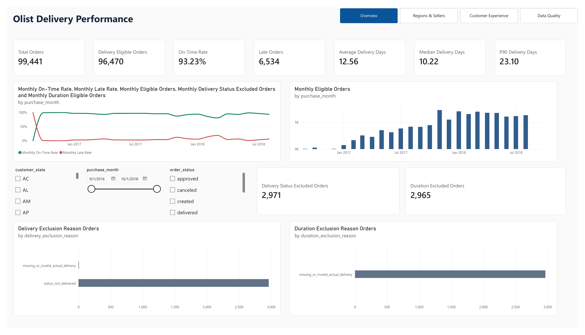
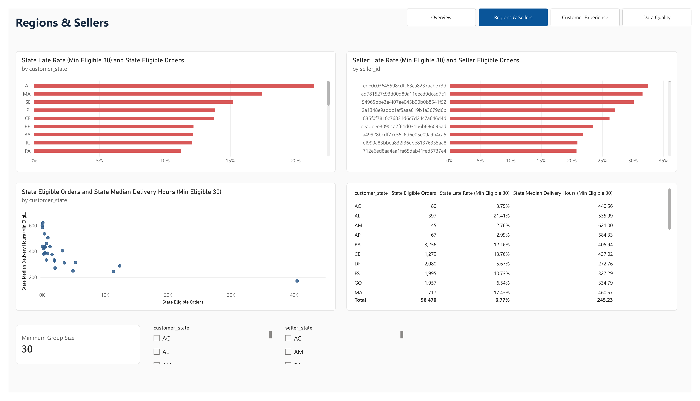
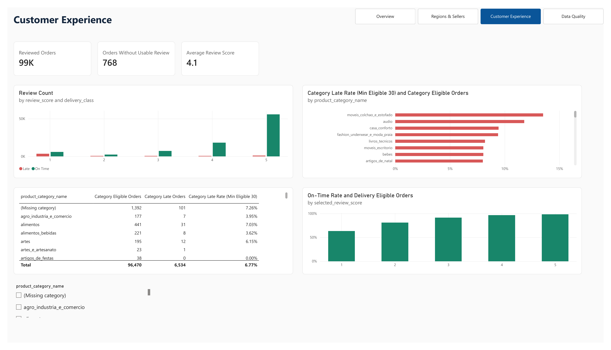
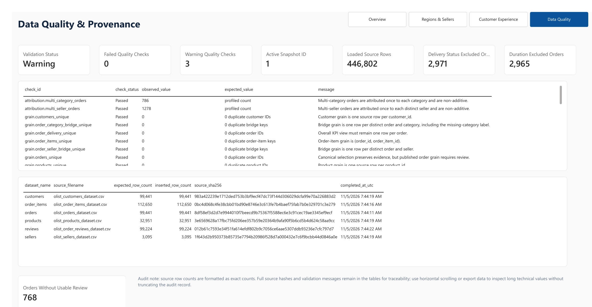

# Olist Delivery Performance Analysis


This project analyzes delivery performance and customer satisfaction using the Brazilian Olist e-commerce dataset. I used **Python and SQL Server** to process, validate, and analyze **99,441 orders**, and developed a **four-page Power BI dashboard** to explore delivery trends, regional differences, seller performance, and customer reviews.

The analysis found that **93.23% of eligible orders arrived on time**, while late orders were delayed by **10.62 days on average**. São Paulo and Rio de Janeiro together accounted for **50.73% of late orders**. Late deliveries were also associated with substantially more one-star customer reviews.

### Key Performance Highlights


## Verified Snapshot #1 KPIs

| Metric | Reconciled value |
| --- | ---: |
| Source orders | 99,441 |
| Delivered orders | 96,478 |
| Delivery-eligible orders | 96,470 |
| On-time orders | 89,936 |
| Late orders | 6,534 |
| On-time rate | 93.23% |
| Late rate | 6.77% |
| Average delivery duration | 12.56 days |
| Median delivery duration | 10.22 days |
| P90 delivery duration | 23.10 days |
| Delivery-status exclusions | 2,971 |
| Duration exclusions | 2,965 |

The generated `reports/metric_reconciliation.json` records 15 passing Python-to-SQL
KPI checks for this snapshot. The dashboard's State Detail and Category Detail
global benchmark totals were also verified in Power BI Desktop by the project
operator. See the [detailed findings](docs/ANALYSIS_FINDINGS.md) for definitions,
evidence paths, and limits.

## Power BI dashboard

The editable PBIP/PBIR/TMDL report has four implemented pages:

- **Overview** — order-level KPIs, separate exclusion cohorts, and monthly snapshot
  summaries.
- **Regions & Sellers** — thresholded state and seller comparisons at their proper
  grains.
- **Customer Experience** — selected-review outcome distributions and local
  category comparison.
- **Data Quality** — active snapshot, validation status, provenance, and
  exclusions.

The following operator-produced screenshots are from the validated Snapshot #1
report. They show the report's rendered content, not a claim that every interaction
has been retested after subsequent edits. See the
[screenshot checklist](docs/SCREENSHOT_CHECKLIST.md) for the capture and privacy
requirements.

### Overview

The overview combines the reconciled order-level KPI cards with purchase-month
rate/volume summaries and separate delivery-status and duration exclusion reasons.



### Regions & Sellers

This page compares thresholded state and seller late rates, state volume versus
median delivery hours, and a State Detail table whose total row is the global
order-level benchmark rather than a state roll-up.



### Customer Experience

This page shows selected-review distributions by delivery outcome, the local
category comparison, and the Category Detail global benchmark. Its review cards use
an all-order scope, which is distinct from the delivery-eligible review cohort used
for the one-star findings.



### Data Quality

This page presents the active snapshot, validation status, warning and failure
counts, explicit exclusion populations, validation checks, and source provenance.



The report uses intentionally disconnected monthly, state, seller, category,
review, quality, and provenance summaries. Page-1 order-level slicers do not filter
the monthly snapshot charts; local state, seller-state, and category slicers affect
only their designated disconnected comparisons. State and Category Detail total
rows are explicit global order-level benchmarks, not sums of summary rows. The
screenshots show page-tab visuals, but native page navigation and Clear all slicers
controls remain runtime-unverified and are not presented as working functionality.

## Key findings

- **Reliable but not uniform:** 93.23% of eligible orders met the estimated
  calendar-date commitment; 6,534 did not.
- **Late orders are often material delays:** the late-order median is 7 calendar
  days and P90 is 22 days, alongside a 10.22-day median total delivery duration.
- **Very short promise windows have the highest observed late rate:** 25.65% for
  fewer than three promised days (49 of 191), versus 6.77% overall. This is
  descriptive, not proof of optimal promise calibration.
- **Late volume is concentrated but rates differ:** SP and RJ account for 50.73% of
  distinct late orders; their late rates are 4.49% and 12.11%, respectively.
- **Exclusions are material context:** 2,971 delivery-status and 2,965 duration
  exclusions are reported separately instead of becoming zero values.
- **Reviews differ descriptively by delivery outcome:** among selected usable
  reviews, 3,431 of 6,381 late orders (53.77%) had one star, versus 5,920 of 89,443
  on-time orders (6.62%). This is an association, not a causal estimate.

## Evidence-bounded recommendations

1. **Track late-order severity as well as rate:** use the 7-day median and 22-day
   P90 to focus on material misses, not only marginal lateness.
2. **Start geographic investigation with SP and RJ,** balancing their combined
   50.73% late-volume share with their different late rates.
3. **Review short promised-window cohorts first,** then test policy changes
   prospectively rather than inferring causality from the historical bands.
4. **Keep delivery-status and duration exclusions visible** in every performance
   view and retain non-additive seller/category warnings.
5. **Use review differences as a diagnostic signal,** then evaluate interventions
   with product, geography, and service confounders in mind.

## Data and architecture

The analysis uses six public Olist source CSVs (**446,802** staged records). Raw
files and generated outputs are intentionally Git-ignored; provenance, row counts,
and hashes are recorded in each snapshot artifact.


The primary grain is one canonical order. Seller and category outputs use distinct
order-group bridges and must not be summed into global order totals. Full design:
[architecture](docs/ARCHITECTURE.md),
[data dictionary](docs/DATA_DICTIONARY.md), and
[KPI definitions](docs/KPI_DEFINITIONS.md).

## Reproducibility and quality

Snapshot #1 has a `Warning` validation status with no failed checks and three
warnings: missing product-category labels, multiple source reviews for an order,
and orders without items. The model preserves these limitations explicitly. The
operator supplied current verification evidence: Ruff lint passed, Ruff formatting
passed for 45 files, and the offline suite reported **72 passed, 1 deselected**.

Follow the [manual runbook](docs/MANUAL_RUNBOOK.md) for the real sequence:

```text
source CSV → Python inventory/load → SQL Server validation/reconciliation
→ reporting export → Power BI refresh and Desktop checks
```

The tracked PBIP contains machine-specific CSV partitions. A new machine must
create or select one complete export directory and update all eight TMDL partition
paths before refreshing. Never mix files from two snapshots or commit credentials,
raw data, exports, or local Power BI state.

## Tools

Python 3.13, pandas, SQL Server, T-SQL, pyodbc, Power BI PBIP/PBIR/TMDL, and Git.

## Repository guide

| Start here | Contents |
| --- | --- |
| [`docs/ANALYSIS_FINDINGS.md`](docs/ANALYSIS_FINDINGS.md) | Evidence, findings, limitations, and pending analyses |
| [`docs/MANUAL_RUNBOOK.md`](docs/MANUAL_RUNBOOK.md) | Environment, SQL Server, validation, export, and Power BI workflow |
| [`sql/`](sql/) | Ordered database objects and read-only analysis queries |
| [`src/olist_delivery/`](src/olist_delivery/) | Inventory, loading, validation, reconciliation, and export code |
| [`powerbi/`](powerbi/) | Editable PBIP/PBIR/TMDL project, model notes, and reconciliation checklist |
| [`tests/`](tests/) | Offline and opt-in SQL Server test coverage |

## Limitations and next steps

The dataset is historical, timestamps have no declared timezone, and the dashboard
is an analytical snapshot rather than a live service. Descriptive state, seller,
category, and review differences can be confounded by geography, product mix,
carrier operations, and selection effects. The next evidence-producing step is to
re-run Q7–Q9 in [`sql/006_analysis_queries.sql`](sql/006_analysis_queries.sql) only
after a data or logic change, then update the documented results from the new
validated snapshot.
